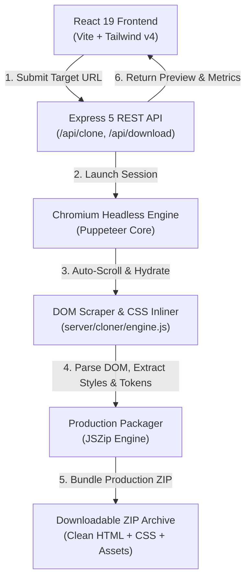

<div align="center">

# ⚡ Zippix Web
### Next-Generation Webpage Reconstructor, Asset Ripper & Design Token Extractor

[](https://react.dev/)
[](https://tailwindcss.com/)
[](https://vitejs.dev/)
[](https://nodejs.org/)
[](https://expressjs.com/)
[](https://pptr.dev/)
[](LICENSE)

<br />

**Zippix Web** is an enterprise-grade, full-stack web application designed to reconstruct any live webpage into clean, production-ready source code, modern CSS, extracted assets, and design tokens in seconds.

Built with an **Apple-inspired dark glassmorphic design system**, precision 3D animated isometric branding, and a headless Chromium engine.

---

</div>

## 📑 Table of Contents

- [✨ Key Capabilities](#-key-capabilities)
- [🏗️ System Architecture](#️-system-architecture)
- [📁 Professional Directory Structure](#-professional-directory-structure)
- [🚀 Quick Start & Installation](#-quick-start--installation)
- [🔌 REST API Reference](#-rest-api-reference)
- [🎨 Design System & Aesthetics](#-design-system--aesthetics)
- [📦 Output Package Specification](#-output-package-specification)
- [🛠️ Configuration & Deployment](#️-configuration--deployment)
- [📄 License & Credits](#-license--credits)

---

## ✨ Key Capabilities

### 1. 🌐 Zero-Friction Full-DOM Reconstruction
- **Deep Headless Hydration**: Leverages native Chromium with stealth execution headers to bypass basic anti-bot blockers and execute heavy React, Vue, Next.js, and Svelte client-side scripts.
- **Scroll-Aware Asset Capture**: Automatically performs orchestrated scroll cycles across the entire document height to trigger lazy-loaded images, SVG graphics, and viewport-dependent animations.
- **Intelligent CSS Inlining**: Consolidates complex external stylesheets, `@import` trees, and `<style>` blocks into a unified, conflict-free cascade.

### 2. 🎨 Design Token & Style Matrix Extraction
- **Tailwind CSS v4 `@theme`**: Generates a drop-in `theme.css` containing extracted typography, color palettes, spacing variables, and border radii.
- **Tailwind CSS v3 Compatibility**: Outputs legacy `tailwind.config.js` for existing workflows.
- **CSS Custom Properties**: Exports root CSS variables (`variables.css`) and machine-readable `tokens.json` for design system integration.

### 3. 📱 Multi-Device Sandboxed Studio
- **Isolated Iframe Sandbox**: Preview reconstructed pages safely with strict script sandboxing.
- **Responsive Viewport Toggles**:
  - 🖥️ **Desktop** (1440px / 100%)
  - 💻 **Laptop** (1024px)
  - 📱 **Tablet** (768px)
  - 📱 **Mobile** (375px)
- **Live Source Code Inspector**: Instant syntax-highlighted tabs for HTML, CSS, Tailwind configuration, and design tokens.

### 4. 📦 1-Click Production ZIP Packaging
- Bundles complete standalone offline artifacts with sanitized asset paths:
  - `index.html` (Standalone, self-contained offline DOM)
  - `assets/` (Scraped vector graphics, SVG icons, and images)
  - `theme.css` (Tailwind v4 tokens)
  - `tailwind.config.js` (Tailwind v3 configuration)
  - `variables.css` (CSS Custom properties)
  - `tokens.json` (Structured JSON design tokens)
  - `README.md` (Extraction report and manifest)

### 5. 💎 Apple Glassmorphism & Micro-Interactions
- Borderless frosted-glass floating navigation with frictionless modal workflows.
- Multi-layered 3D isometric floating logo with smooth ambient glow meshes.
- Single-viewport above-the-fold hero layout with zero overflow or cramped elements.
- Embedded authentication modal (Sign In / Sign Up) and Pro quota management.

---

## 🏗️ System Architecture



---

## 📁 Professional Directory Structure

The repository is organized following clean architectural boundaries:

```text
zippix-web/
├── api/                           # Serverless entry points (Vercel deployment)
│   ├── clone.js                   # Serverless clone handler
│   └── health.js                  # Health check endpoint
├── public/                        # Static application assets
│   ├── favicon.svg                # Application favicon
│   └── logo.svg                   # Brand vector logo
├── server/                        # Backend REST API & Reconstruction Engine
│   ├── cloner/                    # Core scraping & packaging modules
│   │   ├── browser.js             # Puppeteer launcher with native Chrome detection
│   │   ├── engine.js              # DOM scraper, asset parser & CSS inliner
│   │   └── packager.js            # JSZip production bundler
│   └── index.js                   # Express server entry point (port 5000)
├── src/                           # React 19 Client Application
│   ├── components/                # Focused UI Components
│   │   ├── AboutModal.jsx         # About Zippix modal
│   │   ├── AnimatedHeroLogo.jsx   # 3D isometric glowing animated logo backdrop
│   │   ├── AuthModal.jsx          # Apple-glass Authentication modal (Sign In / Up)
│   │   ├── CloneDashboard.jsx     # Cloned page preview, code editor & asset grid
│   │   ├── CloneProgress.jsx      # Multi-stage cloning status indicator
│   │   ├── ContactModal.jsx       # Contact & support modal
│   │   ├── FaqSection.jsx         # Frequently Asked Questions accordion
│   │   ├── Header.jsx             # Apple-style borderless glassmorphic navigation
│   │   ├── PrivacyModal.jsx       # Privacy Policy modal
│   │   ├── ProUpgradeModal.jsx    # Pro license activation & checkout modal
│   │   ├── StudioPlayground.jsx   # Interactive preview playground
│   │   ├── TermsModal.jsx         # Terms of Service modal
│   │   └── UrlInputBar.jsx        # Target URL input with preset pills
│   ├── App.jsx                    # Root React component & state orchestration
│   ├── index.css                  # Tailwind v4 theme directives & glass tokens
│   └── main.jsx                   # React 19 client bootstrap
├── .gitignore                     # Git exclusion rules
├── index.html                     # HTML5 single-page application entry point
├── package.json                   # Project metadata, dependencies & scripts
├── package-lock.json              # Deterministic dependency lockfile
├── README.md                      # Comprehensive project documentation
├── start.bat                      # Windows double-click instant launcher
├── vercel.json                    # Vercel cloud deployment specification
└── vite.config.js                 # Vite development & build configuration
```

---

## 🚀 Quick Start & Installation

### Prerequisites

- **Node.js**: `v18.0.0` or higher ([Download Node.js](https://nodejs.org/))
- **Google Chrome / Chromium**: Installed locally on the host machine.
- **npm** or **pnpm** / **yarn**

### 1. Clone the Repository

```bash
git clone https://github.com/yashsingh-14/zippix-web.git
cd zippix-web
```

### 2. Install Dependencies

```bash
npm install
```

### 3. Launch Development Server

Run both the Vite frontend (`http://localhost:3000`) and the Express API server (`http://localhost:5000`) concurrently:

```bash
npm run dev
```

> **Windows Users**: You can also double-click `start.bat` in the project root to launch immediately!

### 4. Build for Production

```bash
npm run build
```

The optimized static output will be generated inside `/dist`.

---

## 🔌 REST API Reference

### 1. Reconstruct Webpage

- **Endpoint**: `POST /api/clone`
- **Content-Type**: `application/json`

#### Request Body
```json
{
  "url": "https://example.com",
  "options": {
    "viewport": { "width": 1440, "height": 900 },
    "extractTokens": true,
    "inlineStyles": true
  }
}
```

#### Response Structure
```json
{
  "success": true,
  "html": "<!DOCTYPE html><html>...</html>",
  "css": "/* Unified stylesheet */",
  "tokens": {
    "colors": ["#0f172a", "#38bdf8", "#818cf8"],
    "fonts": ["Inter", "system-ui", "sans-serif"],
    "tailwindConfig": "{ ... }"
  },
  "assets": [
    { "type": "image", "src": "https://example.com/hero.png" }
  ],
  "downloadId": "zippix_cloned_179320"
}
```

### 2. Download Packaged ZIP

- **Endpoint**: `POST /api/download`
- **Response**: Binary `application/zip` stream.

---

## 🎨 Design System & Aesthetics

Zippix Web adheres to modern design principles inspired by Apple's Human Interface Guidelines and dark luxury interfaces:

| Token Name | Value / Treatment | Description |
| :--- | :--- | :--- |
| **Canvas Background** | `#030712` (Rich Obsidian Dark) | Deep, distraction-free neutral backdrop |
| **Accent Primary** | `#38bdf8` (Luminous Sky Blue) | Primary focus states and neon edge sweeps |
| **Accent Secondary**| `#818cf8` (Indigo Purple) | Gradients and 3D layer facets |
| **Accent Tertiary** | `#c084fc` (Soft Violet) | Subtle atmospheric glow highlights |
| **Apple Glass Nav** | `backdrop-blur-2xl bg-slate-950/20` | Completely borderless floating header bar |
| **Card Surface** | `bg-white/[0.03] backdrop-blur-xl` | Ultra-subtle translucent glass cards |

---

## 📦 Output Package Specification

When a webpage is cloned and downloaded, the output archive contains:

```text
reconstructed-package/
├── assets/                  # Extracted and locally linked SVGs and images
├── index.html               # Sanitized, offline-compatible HTML5 document
├── style.css                # Inlined, unified stylesheet
├── theme.css                # Tailwind CSS v4 `@theme` block
├── tailwind.config.js       # Tailwind CSS v3 configuration file
├── variables.css            # Root CSS Custom Properties
├── tokens.json              # Structured JSON design token dictionary
└── README.md                # Reconstruction log & setup instructions
```

---

## 🛠️ Configuration & Deployment

### Environment Variables (Optional)

Create a `.env` file in the project root:

```env
PORT=5000
VITE_API_URL=http://localhost:5000
PUPPETEER_EXECUTABLE_PATH=C:\Program Files\Google\Chrome\Application\chrome.exe
```

### Vercel Deployment

The project includes pre-configured serverless function routing via [`vercel.json`](vercel.json). To deploy:

```bash
npx vercel
```

---

## 📄 License & Credits

Distributed under the **MIT License**. See `LICENSE` for more information.

- **Author**: [Yash Singh](https://github.com/yashsingh-14)
- **Repository**: [https://github.com/yashsingh-14/zippix-web](https://github.com/yashsingh-14/zippix-web)

<div align="center">
<sub>Crafted with passion using React 19, Tailwind CSS v4, and Node.js</sub>
</div>
